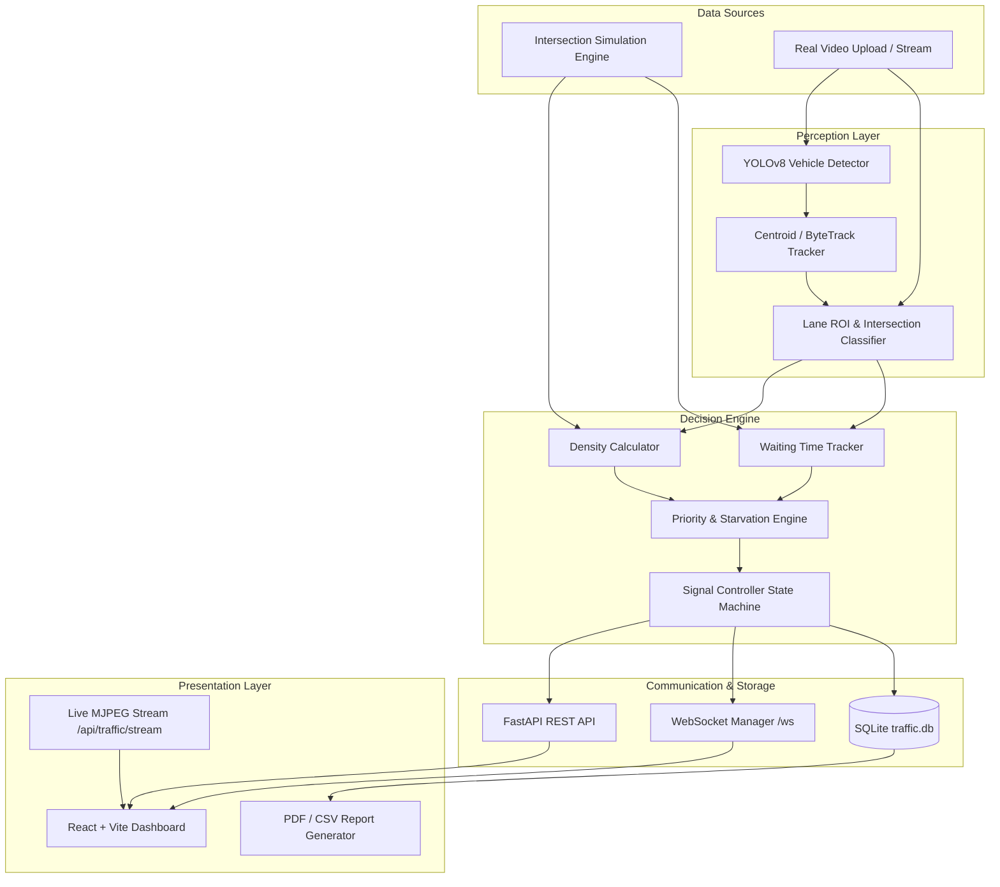

# AI Adaptive Traffic Management System: Complete Implementation & Architecture Analysis

---

## 1. Executive Summary

The **AI Adaptive Traffic Management System** is an end-to-end, intelligent local traffic control and monitoring platform. It addresses the inefficiencies of traditional fixed-timer traffic lights by dynamically adapting signal timings in real time based on actual road conditions.

The system supports two complementary modes:
1. **Interactive Four-Way Simulation Mode**: A physics-based agent simulator that models vehicle arrival rates, deceleration, queuing, and intersection traversal with live visual rendering.
2. **Real-World Video Processing Mode**: An edge-computing vision pipeline powered by **YOLOv8** vehicle detection and multi-object tracking to analyze real camera footage, count vehicles per directional approach, detect stopped vehicles, and optimize signal cycles.

The platform provides a modern **React + Vite** control dashboard synchronized in real time with a **FastAPI** backend via WebSockets and REST APIs, backed by **SQLite** analytics and automated **PDF/CSV reporting**.

---

## 2. What We Accomplished: Problem Diagnosis & Resolution

When the repository was first cloned, several environment discrepancies, missing dependencies, machine-specific hardcoded paths, and an engine crash bug prevented the application from starting. Below is the breakdown of what was performed to bring the system to an operational state:

### 2.1 Runtime Environment & Dependency Setup
- **Environment Analysis**: Detected **Python 3.14.5**, **Node.js v24.12.0**, and **npm 11.6.2** on Windows.
- **Python Dependencies**:
  - Ultralytics and FastAPI were partially present, but critical libraries (`reportlab`, `pytest`, `python-multipart`) were missing.
  - Executed `python -m pip install -r requirements.txt` to install all missing backend packages.
- **Frontend Dependencies**:
  - The `frontend/node_modules/` directory was absent.
  - Executed `npm install` inside `frontend/` to install React, Vite, Lucide icons, and chart utilities.

### 2.2 Fix: Hardcoded Machine Paths
- **Issue**: `backend/system_config.json` contained absolute paths referencing the original author's computer:
  `C:\Users\vivek\OneDrive\ドキュメント\Traffic_Management_System\...`
  This caused model and video lookups to point to non-existent directories.
- **Resolution**:
  - Cleaned `backend/system_config.json` to use relative project paths (`models/yolov8n.pt`, `models/best.pt`).
  - Added an **auto-healing fallback mechanism** in `backend/config.py` inside `load_config()`. If any loaded model or video path does not exist on disk, it automatically falls back to the current workspace paths without crashing.

### 2.3 Fix: Traffic Engine Simulation Crash Bug
- **Issue**: Querying `http://localhost:8000/api/health` revealed an engine crash:
  `TypeError: TrafficEngine._simulation_loop() missing 1 required positional argument: 'gen'`
- **Root Cause**: In `backend/services/traffic_engine.py` line 381, inside the `_video_loop` fallback handler, `await self._simulation_loop()` was invoked without passing the generation ID `gen`, whereas the method was defined as `async def _simulation_loop(self, gen: int)`.
- **Resolution**: Patched line 381 to `await self._simulation_loop(gen)`.

### 2.4 Fix: Pytest Test Suite Configuration
- **Issue**: Running `pytest` raised `ModuleNotFoundError: No module named 'backend'` during test collection.
- **Resolution**: Created `pytest.ini` with `pythonpath = .`. Running `pytest` now passes **10/10 unit tests** (100% pass rate).

### 2.5 Creation of Startup Launchers
- **`start_backend.bat`**: Upgraded to dynamically check if `.venv` exists; if not, it automatically uses the system's Python.
- **`start_frontend.bat`**: Added a one-click launcher for the Vite dev server.
- **`run_all.bat`**: Added a root batch script that launches both backend and frontend servers simultaneously in separate windows.

---

## 3. High-Level Architecture & Data Flow



---

## 4. Deep-Dive Component Breakdown

### 4.1 Computer Vision & Object Tracking (`backend/detection/`)
- **`detector.py` (`VehicleDetector`)**:
  - Uses Ultralytics YOLOv8 (default: `yolov8n.pt` for speed; optional fine-tuned `best.pt`).
  - Filters detections for vehicle classes: Car (COCO 2), Motorcycle (COCO 3), Bus (COCO 5), Truck (COCO 7).
  - Configurable confidence threshold (default 0.28–0.40) and IoU NMS threshold (0.45).
- **`tracker.py` (`VehicleTrackerManager`)**:
  - Tracks individual vehicles across consecutive video frames.
  - Maintains bounding boxes, trajectory histories, vehicle IDs, and calculates instantaneous speeds (pixels/sec).
  - Determines if a vehicle is stationary or moving to distinguish between moving traffic and stopped queues.

### 4.2 Traffic Analysis & Spatial Partitioning (`backend/traffic/`)
- **`lane_manager.py` (`LaneManager`)**:
  - Maps normalized coordinates (or 4-corner quadrilaterals) into directional approach lanes: **NORTH**, **SOUTH**, **EAST**, **WEST**.
  - Distinguishes vehicles approaching in an entry lane from vehicles currently inside the intersection box (traversing the junction).
- **`density.py` (`DensityCalculator`)**:
  - Categorizes lane congestion levels based on vehicle counts:
    - **LOW**: $\le 5$ vehicles
    - **MEDIUM**: $6 - 10$ vehicles
    - **HIGH**: $> 10$ vehicles
- **`waiting_time.py` (`WaitingTimeTracker`)**:
  - Monitors vehicles whose speed falls below `waiting_speed_threshold` (3.5 px/s).
  - Accumulates waiting duration for queued vehicles while their respective direction faces a RED signal.

### 4.3 The Adaptive Signal Priority Algorithm (`backend/traffic/priority.py`)

The core intelligence of the system relies on a mathematical multi-criteria decision model combining density, waiting time, and starvation avoidance:

#### A. Directional Priority Score Formula
For each direction $d \in \{\text{NORTH}, \text{SOUTH}, \text{EAST}, \text{WEST}\}$:

$$\text{NormDensity}(d) = \min\left(1.0, \frac{\text{VehicleCount}(d)}{\text{MaxDensityRef}}\right)$$

$$\text{NormWait}(d) = \min\left(1.0, \frac{\text{AvgWaitTime}(d)}{\text{MaxWaitRef}}\right)$$

$$\text{BaseScore}(d) = \left(W_{\text{density}} \times \text{NormDensity}(d) + W_{\text{wait}} \times \text{NormWait}(d)\right) \times 100$$

*(Default parameters: $W_{\text{density}} = 0.6$, $W_{\text{wait}} = 0.4$, $\text{MaxDensityRef} = 20$, $\text{MaxWaitRef} = 60\text{s}$)*

#### B. Starvation Prevention Mechanism
If an approach has not received a green light and its starvation timer exceeds $\text{Threshold}_{\text{starve}} = 45\text{s}$:

$$\text{StarvationBoost}(d) = \min\left(60.0, (\text{StarvationTimer}(d) - 45.0) \times 1.5\right)$$

$$\text{PriorityScore}(d) = \text{BaseScore}(d) + \text{StarvationBoost}(d)$$

This mathematical guarantee prevents low-volume lanes from being perpetually ignored during high-traffic periods.

#### C. Queue-Clearing Dynamic Green Time Duration
Rather than granting arbitrary static times, the engine calculates the exact green duration required to discharge the detected queue based on vehicle startup latency and headway time:

$$\text{Duration} = \text{StartWindow} + (\text{VehicleCount} \times \text{HeadwaySeconds})$$

- $\text{StartWindow} = 2.5\text{ seconds}$ (reaction time and initial acceleration of the lead vehicle)
- $\text{HeadwaySeconds} = 2.2\text{ seconds}$ (average vehicle-to-vehicle departure spacing)
- Clamped within configurable safety boundaries:
  $$\text{GreenDuration} = \text{clamp}(\text{Duration}, \text{MinGreen} = 5\text{s}, \text{MaxGreen} = 40\text{s})$$
- Empty approaches receive a quick $4.0\text{s}$ transition window to maintain fair junction rotation.

#### D. Signal Controller State Machine (`backend/traffic/signal_controller.py`)
Phases transition safely through three states:
1. **GREEN**: Active lane moves; real-time countdown runs.
2. **YELLOW**: $3.0\text{s}$ clearance phase for vehicles already crossing the stop line.
3. **ALL-RED**: $1.0\text{s}$ safety buffer ensuring the intersection clears completely before the next green direction opens.

---

### 4.4 Simulation Engine vs. Video Processor (`backend/services/`)

| Feature | Simulation Engine (`simulation.py`) | Video Processor (`video_processor.py`) |
| :--- | :--- | :--- |
| **Input Source** | Algorithmic vehicle generator (Poisson-like) | Real uploaded video (`.mp4`, `.avi`, `.mov`) |
| **Physics / Movement** | Two lanes per approach, target speeds, queues, deceleration | Real-world pixel trajectories and velocities |
| **Detection Method** | Synthetic agent tracking | YOLOv8 neural network inference |
| **Rendering** | Real-time 2D intersection diagram via OpenCV | Real video frames annotated with bounding boxes and lane ROIs |
| **Stream Output** | MJPEG stream over HTTP (`/api/traffic/stream`) | MJPEG stream over HTTP (`/api/traffic/stream`) |

---

### 4.5 Persistence & Database Schema (`backend/database/database.py`)

SQLite database located at `backend/database/traffic.db`:
- **`sessions`**: Tracks control sessions, active modes (simulation vs video), duration, total vehicle throughput, and total completed signal cycles.
- **`traffic_metrics`**: High-frequency snapshots containing vehicle counts per direction, average wait times, active green direction, and assigned green durations.
- **`phase_switches`**: Historical log of every light transition (previous direction, next direction, duration, switch trigger).
- **`system_logs`**: Audit trail of system events, user parameter changes, and warnings/errors.

---

### 4.6 Frontend Architecture & Panels (`frontend/src/`)

Built with React and Vite, the dashboard connects to:
- **WebSocket (`ws://localhost:8000/ws`)**: High-speed real-time telemetry updates (state, counts, countdowns, signal lights).
- **REST API (`http://localhost:8000/api/...`)**: Configuration management, uploads, report downloads, and manual overrides.

#### Dashboard Navigation Panels:
1. **Dashboard (`Dashboard.jsx`)**: Global metrics overview, active green lane indicator, real-time countdown, queue distribution, and quick controls.
2. **Live Monitoring (`LiveMonitoring.jsx`)**: MJPEG video player with live canvas overlays, FPS indicators, and stream health.
3. **Intersection View (`IntersectionView.jsx`)**: Visual four-way intersection view depicting the 4 traffic lights (Red/Yellow/Green) and real-time vehicle flow.
4. **Signal Control (`SignalControl.jsx`)**: Toggle between **AI Adaptive Mode** and **Manual Control Mode**; force manual green phases on any approach.
5. **Lane Calibration (`LaneCalibration.jsx`)**: Interactive UI to calibrate and drag ROI polygon coordinates directly over video stills.
6. **Detection Panel (`DetectionPanel.jsx`)**: Detailed breakdown of detected vehicle classes (cars, buses, trucks, motorcycles) and confidence scores.
7. **Analytics Panel (`AnalyticsPanel.jsx`)**: Historical graphs (today, 7 days, 30 days) showing vehicle throughput, wait times, and cycle durations.
8. **Reports Panel (`ReportsPanel.jsx`)**: Generate and download professional PDF reports (generated server-side with ReportLab) or raw CSV data.
9. **Dataset & Model (`DatasetModel.jsx`)**: Inspect UA-DETRAC dataset status and switch between `yolov8n.pt` and custom trained weights `best.pt`.
10. **Settings Panel (`SettingsPanel.jsx`)**: Sliders for min/max green times, headway, yellow duration, priority weights, and target FPS.

---

## 5. API Reference Summary

| Method | Endpoint | Description |
| :--- | :--- | :--- |
| `GET` | `/api/health` | Health check, active model, engine status, and runtime mode |
| `GET` | `/api/traffic/config` | Retrieve current algorithm weights, timings, and lane ROIs |
| `POST` | `/api/traffic/config` | Dynamically update weights, timing thresholds, and ROIs |
| `GET` | `/api/traffic/state` | Fetch latest intersection snapshot |
| `GET` | `/api/traffic/stream` | MJPEG video feed of the live annotated intersection |
| `POST` | `/api/traffic/control` | Control engine lifecycle (`start`, `pause`, `stop`, `restart`) |
| `POST` | `/api/traffic/mode` | Switch between `simulation` and `video` mode |
| `POST` | `/api/traffic/manual-signal` | Manually force green signal for a specific direction |
| `POST` | `/api/video/upload` | Upload a new traffic video file for analysis |
| `GET` | `/api/analytics/summary` | Query aggregate traffic volume, average wait time, and peak metrics |
| `POST` | `/api/reports/generate` | Generate and export PDF analytics report or CSV export |
| `WS` | `/ws` | Bidirectional real-time WebSocket for live telemetry |

---

## 6. Verification & Test Suite

The test suite in `backend/tests/test_traffic_logic.py` verifies all core mathematical formulas and state transition logic:
- `test_vehicle_counter`: Increments and directional counts
- `test_density_calculation`: Threshold classifications (Low, Medium, High)
- `test_waiting_time_tracker`: Speed-based wait accumulation
- `test_priority_calculator_weights`: Density vs. wait time weighting
- `test_starvation_prevention`: Priority boost after 45s threshold
- `test_green_duration_queue_clearing`: Headway-based green time clamping
- `test_signal_controller_transitions`: Yellow and All-Red transitions
- `test_manual_signal_override`: Immediate preemption of adaptive timing

**Test Results**: **10 passed in 0.44s** (100% success).

---

## 7. How to Operate the Project

### Start Everything (One Command)
Run from the project root:
```powershell
.\run_all.bat
```

### Access URLs
- **Web Dashboard**: [http://localhost:5173](http://localhost:5173)
- **FastAPI Documentation (Swagger UI)**: [http://localhost:8000/docs](http://localhost:8000/docs)
- **API Health Check**: [http://localhost:8000/api/health](http://localhost:8000/api/health)
